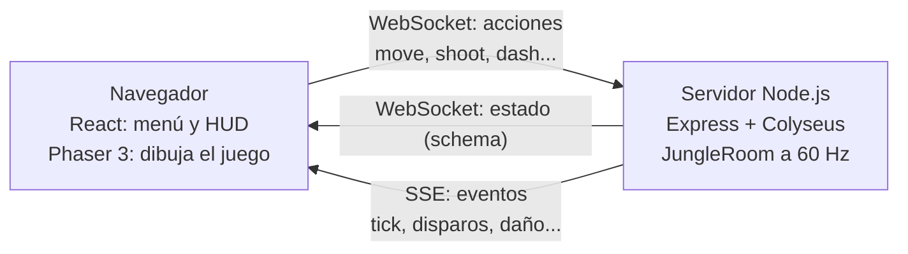

<div align="center">

# 🐱 BattleCats

**Battle royale 2D multijugador en red, donde los jugadores son gatos.**


Proyecto de la materia **Redes** · Instituto Leibnitz, Villa María

</div>

<!-- Agregar acá una captura o un GIF del juego, por ejemplo:  -->

## 🎮 ¿De qué se trata?

Hasta **16 jugadores por sala** (humanos y 6 bots) aparecen en una isla de 8000×8000 px, armados solo con las garras. Hay que explorar, conseguir armas y botiquines, esconderse en arbustos y casas, y sobrevivir a una **zona tóxica que se achica** hasta que queda un solo gato vivo.

- 🔫 **Armas asimétricas:** garras, pistola láser, escopeta, sniper y granadas, cada una con su alcance, daño y recarga.
- 🌀 **Dash y roll:** salto veloz con garras, voltereta de esquiva con armas.
- 👻 **Fantasmas con trampas:** quien muere sigue en la partida y pone trampas a los que quedan.
- 🌿 **Sigilo:** arbustos y casas esconden al gato.
- 💥 **Mundo destructible:** cajas con botín, barriles explosivos, río con puentes y 9 estructuras.
- 🎨 **Pixel art propio** y sonido sintetizado por código.

## 🕹️ Controles

| Acción | Tecla |
|---|---|
| Moverse | `W` `A` `S` `D` |
| Apuntar | Mouse |
| Disparar / atacar | Clic izquierdo (mantener para autodisparo) |
| Dash o roll | `Espacio` |
| Recargar | `R` |
| Recoger o cambiar arma | `F` (o `E` cerca de un ítem) |
| Cambiar de arma | `1` a `5` o rueda del mouse |
| Emote | `E` (sin ítems cerca) |

## 🚀 Cómo correrlo

Requisitos: **Node.js 20+** y npm.

```bash
# 1) Instalar dependencias (una sola vez)
cd server && npm install
cd ../client && npm install
cd ..

# 2) Levantar servidor y cliente juntos
./start.sh          # Mac y Linux
start.bat           # Windows
```

O por separado:

```bash
cd server && npm run dev    # servidor en  http://localhost:2567
cd client && npm run dev    # cliente en   http://localhost:3000
```

Abrí `http://localhost:3000`. Para probar el multijugador, abrí varias pestañas, o conectá otras compus de la misma red usando la IP de la que corre el servidor.

Chequeo rápido del servidor: `http://localhost:2567/health`.

## 🧠 Cómo funciona

El **servidor es autoritativo**: decide posiciones válidas, daño, muertes, zona y botín. Los clientes solo mandan lo que el jugador quiere hacer y dibujan lo que reciben. Para que se sienta fluido, cada cliente se mueve y dispara al instante en su pantalla (predicción) y el servidor valida.



| Canal | Para qué |
|---|---|
| **WebSocket (Colyseus)** | Entrar a la sala, enviar acciones y recibir el estado sincronizado |
| **SSE** (`/api/events`) | Eventos en tiempo real: posiciones, disparos, golpes, explosiones, kills |

No hay base de datos: todo el estado vive en la memoria del servidor mientras la sala está abierta.

## 🛠️ Tecnologías

| Capa | Tecnología |
|---|---|
| Lenguaje | TypeScript |
| Servidor | Node.js, Express, Colyseus (WebSocket), Server-Sent Events |
| Motor del juego | Phaser 3 (WebGL) |
| Interfaz | React 18, Vite, Tailwind CSS, Lucide |
| Arte y sonido | Pixel art (PNG + JSON estilo Aseprite), Web Audio API |

## 📁 Estructura

```
BattleCats/
├── server/src/
│   ├── index.ts              Arranque de Express + Colyseus
│   ├── sse.ts                Canal de Server-Sent Events
│   ├── rooms/JungleRoom.ts   Lógica autoritativa del juego (60 Hz)
│   ├── rooms/schema/         Estado sincronizado
│   └── spatial/              Grilla espacial para colisiones
├── client/src/
│   ├── components/           Menú, HUD y canvas
│   └── game/                 Escena de Phaser, red, sprites, terreno, sonido
├── client/public/sprites/    Arte pixel art
└── docs/                     Documentación técnica
```

## 📚 Documentación

- [`docs/DOCUMENTACION.md`](docs/DOCUMENTACION.md): documentación técnica completa (estructura, funcionalidades, tecnologías y por qué, puntos a revisar).
- [`docs/pixel-art-mundo.md`](docs/pixel-art-mundo.md): cómo se arma el arte del mundo.
- [`docs/fix-bots-congelados.md`](docs/fix-bots-congelados.md): bug de bots inmunes, causa y arreglo.
- [`docs/tecnico-agua-mar.md`](docs/tecnico-agua-mar.md): diseño pendiente del agua del mar.

## 🌿 Flujo de trabajo

```
main   ← versiones estables
  ↑ PR
dev    ← integración
  ↑ PR
nico · alejo · luca · sasha · facu   ← una rama por persona
```

1. Trabajar siempre en la rama propia.
2. Traer `dev` seguido (`git merge dev`) para evitar conflictos grandes.
3. Abrir un Pull Request a `dev`; se revisa y se mergea.
4. Cuando `dev` está estable, se pasa a `main`.

## 👥 Equipo

| Integrante | Rol |
|---|---|
| Nicolás Agnello | Documentación, organización y Git |
| Luca Morales | Base de la app y mecánicas |
| Alejo Schmidt | Arte (pixel art) |
| Sasha Frascarelli | Visual y UI |
| Facundo Henze | HUD y bots |

## 🙏 Créditos

La estética y varias ideas de jugabilidad se inspiran en [Suroi.io](https://suroi.io/) y [Diep.io](https://diep.io/).
